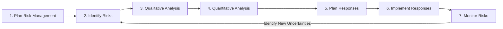
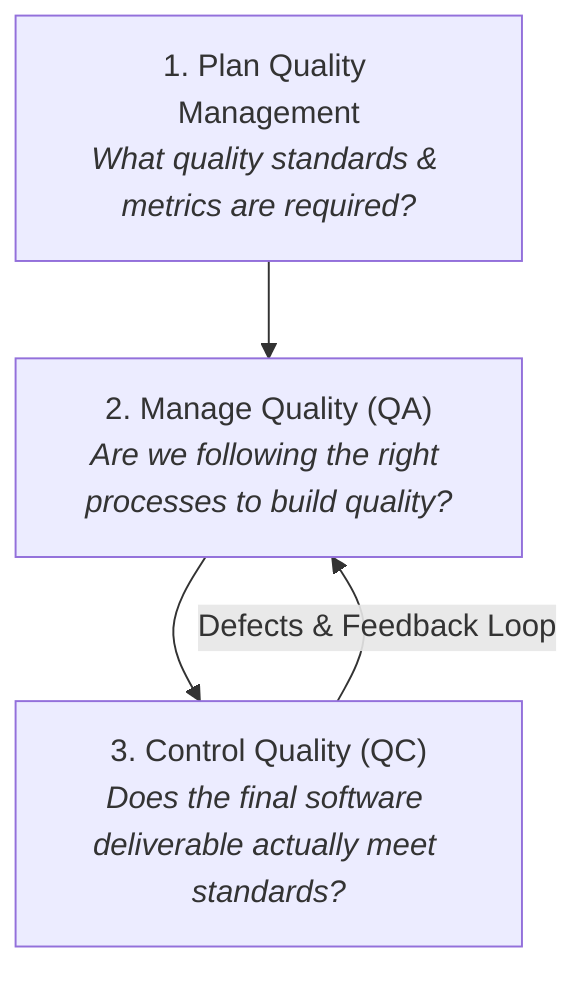
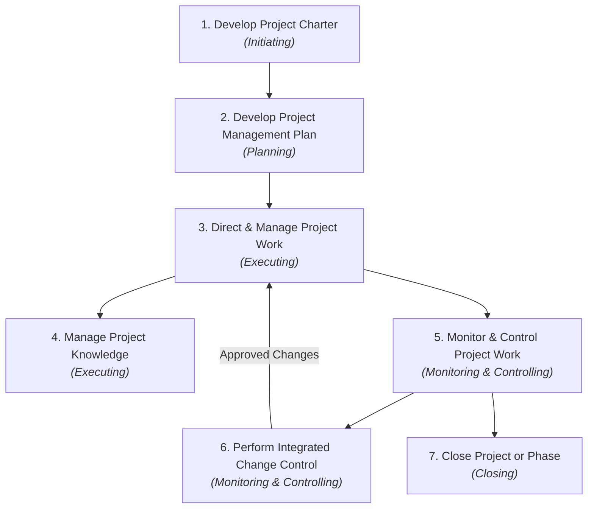

# Lecture 12: Managing IT Projects – Risk, Quality, and Integration Management

**Module:** IT3120 – Modern Enterprise Management (නූතන ව්‍යවසාය කළමනාකරණය)  
**Main Topic:** Managing Uncertainty (Risk), Delivering Value (Quality), and Coordinating Complex Systems (Integration) in Waterfall, Agile, Hybrid, and AI-Assisted Environments  
**Target Audience:** Computing and Information Technology Undergraduates

---

## 1. Introduction

Managing enterprise Information Technology (IT) projects is fundamentally different from managing traditional civil construction or physical manufacturing projects. In civil engineering, building physics, blueprints, and materials are well-established and predictable. In contrast, IT projects operate in an environment of **high volatility and continuous uncertainty (අධික අවිනිශ්චිතතාවය)**: business requirements evolve mid-sprint, software architectures hide deep technical dependencies, third-party cloud APIs experience downtime, cyber threats emerge overnight, and end-user adoption is notoriously unpredictable.

Simply completing an IT project on time and within budget no longer guarantees success. A digital banking application delivered precisely on schedule and within budget is an absolute commercial failure if users encounter transaction errors, if data leaks occur, or if the server crashes under peak load. Modern enterprise management evaluates IT success through three deeply interconnected questions:
1. **Risk Management (අවදානම් කළමනාකරණය):** *What could happen?* (Identifying threats and opportunities before they disrupt the project).
2. **Quality Management (තත්ත්ව කළමනාකරණය):** *How good must the software solution be?* (Ensuring deliverables fulfill user requirements, perform reliably, and prevent defects).
3. **Integration Management (ඒකාබද්ධතා කළමනාකරණය):** *How do we keep all parts working together harmoniously?* (Coordinating scope, schedule, budget, resources, security, and vendors so that changes in one area do not collapse the entire enterprise system).

Furthermore, modern IT leaders do not rely on a single dogmatic methodology. Depending on the nature of the project, managers apply **Predictive (Waterfall)**, **Adaptive (Agile)**, or **Hybrid** frameworks, increasingly augmented by **Generative AI** tools to brainstorm risks, formulate test metrics, and track change impacts.

### Why This Topic Matters
- Over 60% of enterprise software failures stem from unmitigated technical risks, poor quality standards, or uncoordinated scope changes.
- Software Engineers and Tech Leads must learn to write measurable quality acceptance criteria and quantifiable risk statements (Cause $\to$ Event $\to$ Effect) rather than relying on vague assurances like *"the app will be fast."*
- Systems Architects must understand the **Ripple Effect (අතුරු බලපෑම්)**: adding a seemingly minor feature like biometric fingerprint login alters scope, hardware requirements, security compliance, project schedule, vendor licensing, and testing pipelines simultaneously.

### Learning Objectives
After studying these notes, you will be able to:
1. Contrast the **Traditional View** of project success (Iron Triangle: Scope, Time, Cost) with the **Modern View** (Quality, Risk, User Value, and Business Benefits).
2. Compare and select between **Predictive (Waterfall)**, **Adaptive (Agile)**, and **Hybrid** project delivery models.
3. Define **Project Risk (ව්‍යාපෘති අවදානම)** and rigorously differentiate between a **Threat (තර්ජනය)**, an **Opportunity (අවස්ථාව)**, an **Issue (දැනට පවතින ගැටලුව)**, an **Assumption (උපකල්පනය)**, and a **Constraint (සීමාව)**.
4. Classify common IT risks across 8 enterprise categories and structure professional risk statements using the **Cause $\to$ Risk Event $\to$ Effect** framework.
5. Construct and maintain a living **Risk Register (අවදානම් ලේඛනය)**, calculate qualitative **Risk Scores ($P \times I$)**, and map risks on a $5 \times 5$ **Probability–Impact Matrix**.
6. Calculate **Expected Monetary Value (EMV)** for quantitative risk assessment and evaluate decision trees.
7. Select and implement appropriate response strategies for negative threats (**Avoid, Mitigate, Transfer, Accept**) and positive opportunities (**Exploit, Enhance, Share, Accept**).
8. Define software **Quality** and contrast **Quality vs. Grade (තත්ත්වය සහ ශ්‍රේණිය)**.
9. Differentiate the three PMBOK quality processes and distinguish between **Quality Assurance (QA – Process)** and **Quality Control (QC – Product)**.
10. Calculate the **Cost of Quality (CoQ)** by breaking down the **Cost of Conformance** (Prevention & Appraisal) vs. **Cost of Non-Conformance** (Internal & External Failures).
11. Formulate precise, measurable IT quality metrics and construct an actionable **Definition of Done (DoD)** for Agile sprints.
12. Explain the central purpose of **Project Integration Management** and analyze the system-wide impacts of enterprise scope modifications.
13. Sequence the seven PMBOK **Integration Management Processes** and execute formal **Integrated Change Control**.
14. Critically evaluate the capabilities and limitations of **Generative AI** in assisting risk identification, metric formulation, and project governance.

---

## 2. Main Concepts

- **2.1 The Reality of IT Projects: Uncertainty & Modern Project Success**
- **2.2 Methodologies Compared: Predictive (Waterfall), Adaptive (Agile), and Hybrid**
- **2.3 Core Agile Frameworks & Concepts for Managers (Scrum Roles, User Stories, DoD)**
- **2.4 Project Risk Management: Definition, Threats, and Opportunities**
- **2.5 Clear Distinctions: Risk vs. Issue vs. Assumption vs. Constraint**
- **2.6 The 8 Major IT Project Risk Categories**
- **2.7 The Risk Management Lifecycle & 7 PMBOK Processes**
- **2.8 Risk Identification Techniques & Structuring Risk Statements**
- **2.9 The Risk Register & Qualitative Risk Analysis ($P \times I$ Matrix)**
- **2.10 Quantitative Risk Analysis & Expected Monetary Value (EMV)**
- **2.11 Risk Response Strategies: Threats vs. Opportunities**
- **2.12 Risk Management in Agile Environments & AI-Assisted Risk Analysis**
- **2.13 Project Quality Management: Fulfilling Requirements & Quality vs. Grade**
- **2.14 The 10 Software Quality Attributes & Varying System Priorities**
- **2.15 The 3 Quality Management Processes (Plan, Manage, Control Quality)**
- **2.16 Process vs. Product: Quality Assurance (QA) vs. Quality Control (QC)**
- **2.17 The Principle of Prevention & The Cost of Quality (CoQ) Framework**
- **2.18 Formulating Measurable IT Quality Metrics**
- **2.19 Software Testing Classifications & Risk Mitigation**
- **2.20 Quality in Agile: Acceptance Criteria, Definition of Done, and CI/CD Pipelines**
- **2.21 Project Integration Management: The "Big Picture" of IT Delivery**
- **2.22 The Ripple Effect: Real-World Change Impact Analysis**
- **2.23 The 7 PMBOK Integration Management Processes & Change Control Workflow**

---

## 3. Detailed Explanations

### 3.1 The Reality of IT Projects & Modern Project Success

#### Why Are IT Projects Uniquely Difficult to Manage?
Information technology projects suffer from exceptionally high failure rates globally compared to physical engineering disciplines. This difficulty is driven by five fundamental enterprise realities:
1. **Continuous Uncertainty (අඛණ්ඩ අවිනිශ්චිතතාවය):** Customer business needs, market conditions, and competitor features shift rapidly while development is underway.
2. **Hidden Architectural Dependencies (සැඟවුණු තාක්ෂණික පරායත්තතා):** Software components, microservices, third-party databases, and legacy infrastructure interact in highly complex, invisible ways. A patch to one database table can break an unrelated payment gateway.
3. **Invisibility of Progress (ප්‍රගතිය දෘශ්‍යමාන නොවීම):** In civil construction, you can look at a building and verify that 10 floors are built. In software, 90% of the code might be written, but the system may not compile or pass security audits.
4. **Late Defect Discovery (දෝෂ ප්‍රමාද වී මතු වීම):** Subtitle race conditions, concurrency bottlenecks, and memory leaks often only manifest when the system undergoes stress testing under production-level loads.
5. **Unpredictable User Adoption (පරිශීලක හැසිරීම් වල අනාවැකි කළ නොහැකි බව):** Even if an application is bug-free, end users may reject it if the user interface (UI) is counter-intuitive or changes their daily workflow too drastically.

#### Redefining Project Success: Traditional vs. Modern
Historically, project managers were evaluated solely against the **Triple Constraint (Iron Triangle)**: Scope, Time, and Cost. In modern IT management, this criteria is dangerously incomplete.

```
       TRADITIONAL VIEW                         MODERN ENTERPRISE VIEW
    ┌─────────────────────┐            ┌─────────────────────────────────────────┐
    │     Scope (විෂයපථය)   │            │  Scope  +  Time  +  Cost (Iron Triangle) │
    │         ▲           │            ├─────────────────────────────────────────┤
    │        / \          │     VS     │  + Quality (තත්ත්වය)                      │
    │       /   \         │            │  + Risk Management (අවදානම් පාලනය)       │
    │      ▼     ▼        │            │  + User Value (පරිශීලක වටිනාකම)          │
    │ Time ◄─────► Cost   │            │  + Business Benefits (ව්‍යාපාරික ප්‍රතිලාභ)│
    └─────────────────────┘            └─────────────────────────────────────────┘
```

> **Important Real-World Takeaway:** A university mobile app delivered precisely on time and 10% under budget is an absolute **failure** if students cannot register for their semester examinations or if student grades leak onto public forums due to broken authentication. Modern success is about **outcomes that create real enterprise value**, not just completing planned activities.

---

### 3.2 Methodologies Compared: Predictive, Adaptive, and Hybrid

One project management methodology does not fit every enterprise project. The management principles remain universal; how they are applied changes based on project uncertainty.

#### 1. Predictive (Waterfall / Plan-Driven) Approach (පුරෝකථන ප්‍රවේශය)
- **Concept:** A linear, sequential delivery model where the project progresses systematically through distinct stages: **Requirements $\to$ Design $\to$ Development $\to$ Testing $\to$ Deployment $\to$ Maintenance/Closure**.
- **Characteristics:** Comprehensive upfront planning; scope baseline is locked early; formal change control is strictly enforced; testing occurs predominantly near the end of development.
- **When to Use:** Best suited when requirements are crystal-clear, stable, and well-understood from the start, and technology is mature.
- **Example:** Implementing an off-the-shelf **Enterprise Resource Planning (ERP)** core database or financial payroll system for a government agency where legal regulations and accounting rules are strictly fixed.

#### 2. Adaptive (Agile / Change-Driven) Approach (අනුවර්තී ප්‍රවේශය)
- **Concept:** An iterative, value-driven framework that delivers working software in short, fixed-duration cycles called **Sprints (කෙටි වැඩ චක්‍ර)** (typically 1 to 4 weeks).
- **Characteristics:** Requirements evolve continuously; scope is captured as a dynamic **Product Backlog**; cross-functional teams build, test, and demonstrate a working increment every sprint; customer feedback directly shapes the next iteration.
- **When to Use:** Ideal for innovative web apps, consumer mobile products, startups, or platforms where user feedback and market demands change rapidly.

#### 3. Hybrid Approach (මිශ්‍ර ප්‍රවේශය)
- **Concept:** Blending predictive, agile, and modern DevOps practices within the same enterprise initiative to maximize governance while retaining engineering agility.
- **Crucial Rule:** Hybrid is **not a messy compromise**; it is the intentional selection of the most suitable management practice for each distinct layer of the project.
- **Enterprise Structure:**
  - **Predictive (Waterfall):** High-level procurement contracts, capital infrastructure budgeting, data center hardware provisioning, regulatory compliance milestones.
  - **Adaptive (Agile):** Customer-facing UI/UX modules, microservice feature development, dashboard analytics, mobile client features.
  - **DevOps (Automated Operations):** Automated Continuous Integration and Continuous Deployment (CI/CD) pipelines, automated regression test suites, containerized cloud deployment, automated infrastructure monitoring.

---

### 3.3 Core Agile Frameworks & Concepts for Managers

To manage modern IT teams, project managers must understand key Agile/Scrum roles, artifacts, and practices:

#### The Three Core Scrum Roles
- **Product Owner (PO - නිෂ්පාදන හිමිකරු):** The voice of the customer and business. Responsible for defining features, maximizing business value, and prioritizing the **Product Backlog (නිෂ්පාදන වැඩ ලැයිස්තුව)**.
- **Scrum Master (ක්‍රමවේද පහසුකම් සපයන්නා):** A servant-leader and agile coach who removes operational impediments (blockers) for the team, facilitates Scrum ceremonies, and shields developers from external distractions.
- **Development Team (සංවර්ධන කණ්ඩායම):** A self-organizing, cross-functional group of software engineers, UI/UX designers, and QA testers who build the shippable product increment during each sprint.

#### Key Agile Artifacts & Practices
- **Product Backlog:** A prioritized, living list of all features, enhancements, and technical debt awaiting implementation.
- **User Story (පරිශීලක කතාව):** A requirement written from the end-user's perspective following a standard template:
  > *"As a [type of user], I want to [perform some action], so that [achieve a specific business benefit]."*
  - *Example:* "As a registered mobile banking user, I want to **reset my forgotten password via SMS OTP**, so that I can securely regain access to my account without visiting a bank branch."
- **Acceptance Criteria (පිළිගැනීමේ නිර්ණායක):** Explicit, testable boundary conditions that a user story must satisfy before it can be considered functional (e.g., "OTP expires after 120 seconds", "Maximum 3 failed OTP attempts before temporary account lockout").
- **Sprint Backlog:** The subset of product backlog items committed by the team for completion during the current sprint.
- **Increment:** The sum of all completed backlog items delivered at the end of a sprint, which must be fully functional and in a shippable state.
- **Sprint Review:** An end-of-sprint demonstration where the team presents working software to stakeholders to capture feedback.
- **Sprint Retrospective (කණ්ඩායම් පසු විපරම):** A dedicated meeting where the team reflects on its processes, tools, and collaboration to implement continuous process improvements in the next sprint.

---

### 3.4 Project Risk Management: Definition, Threats, and Opportunities

#### What Is Project Risk?
> **Project Risk (ව්‍යාපෘති අවදානම):** An uncertain event or condition that, if it occurs, has a positive or negative effect on one or more project objectives (such as scope, schedule, cost, or quality).

Risk is rooted in **uncertainty (අවිනිශ්චිතතාවය)**. In enterprise management, risk is not exclusively negative:
1. **Threat (තර්ජනය - Negative Risk):** An uncertain event that would damage the project if it occurs (e.g., a critical payment API goes offline, increasing project cost and causing release delays).
2. **Opportunity (අවස්ථාව - Positive Risk):** An uncertain event that would benefit the project if realized (e.g., releasing a new open-source AI library reduces developer coding effort by 30%, finishing the sprint ahead of schedule).

Effective project managers manage both threats (to reduce harm) and opportunities (to capture value).

---

### 3.5 Clear Distinctions: Risk vs. Issue vs. Assumption vs. Constraint

In professional IT project governance and university exams, mixing up these four terms is a catastrophic error.

```
       PAST / PRESENT                         FUTURE (UNCERTAIN)
  ┌───────────────────────────┐         ┌───────────────────────────┐
  │      ISSUE (ගැටලුව)       │         │       RISK (අවදානම)       │
  │ Has ALREADY happened.     │   vs.   │ Might happen in future.   │
  │ Current known problem.    │         │ Uncertainty with impact.  │
  │ Requires immediate action.│         │ Requires response plan.   │
  └───────────────────────────┘         └───────────────────────────┘
```

- **Risk (අවදානම):** Something that *may* happen in the future.
  - *Example:* "Our cloud service provider *might* experience a server outage during peak student exam registration week."
- **Issue (දැනට පවතින ගැටලුව):** Something that *has already occurred* in the present; a realized risk.
  - *Example:* "The cloud database server crashed 20 minutes ago and students currently cannot submit their online exams."
- **Assumption (උපකල්පනය):** Something believed and treated as true, real, or certain for planning purposes without proof or demonstration.
  - *Example:* "We assume the client's internal network infrastructure supports gigabit data transfer rates for our software."
- **Constraint (සීමාව / බාධකය):** A non-negotiable limitation or restriction imposed on the project that dictates boundaries.
  - *Example:* "The project budget is capped at LKR 15,000,000, and the system must launch before December 31 due to central bank regulatory deadlines."

---

### 3.6 The 8 Common IT Project Risk Categories

To ensure no blind spots remain during risk analysis, IT project managers categorize risks across 8 enterprise dimensions:

| Risk Category | Simple Meaning | Common IT Enterprise Examples |
|---|---|---|
| **1. Requirements Risks (අවශ්‍යතා අවදානම්)** | Ambiguous, missing, or volatile client specifications | Client changes database transaction logic halfway through development; vague user stories lead to scope creep. |
| **2. Technical Risks (තාක්ෂණික අවදානම්)** | Emerging, untested, or complex technologies | A new microservice architecture fails under high concurrency; integration between modern cloud API and 20-year-old legacy mainframe fails. |
| **3. Security & Compliance Risks (ආරක්ෂක අවදානම්)** | Vulnerabilities, data leaks, and legal breaches | SQL injection or authentication bypass exposes customer personal data; system violates Personal Data Protection Act (PDPA). |
| **4. People & Resource Risks (මානව සම්පත් අවදානම්)** | Staff turnover, skill shortages, and burnout | Lead Cloud Architect resigns two weeks prior to production deployment; team lacks expertise in Kubernetes orchestration. |
| **5. Schedule Risks (කාලසටහන් අවදානම්)** | Critical path bottlenecks and underestimated tasks | Third-party vendor delays SDK release by two months, preventing user interface integration. |
| **6. Vendor & Supplier Risks (විකුණුම්කරු අවදානම්)** | External service failures and supplier insolvency | Third-party SMS gateway goes bankrupt; AWS/Azure cloud region experiences an unannounced global outage. |
| **7. Business Risks (ව්‍යාපාරික අවදානම්)** | Market rejection and low user adoption | End users refuse to adopt the new automated portal because it requires too many manual verification steps; competing product launches first. |
| **8. External & Legal Risks (බාහිර සහ නීතිමය අවදානම්)** | Regulatory updates, natural disasters, macroeconomic shocks | Currency depreciation spikes cloud subscription costs; new government privacy directive renders current data storage illegal. |

---

### 3.7 The Risk Management Lifecycle & 7 PMBOK Processes

Risk management is an ongoing, iterative feedback loop throughout the project lifecycle—never a one-time checklist filled out during project kick-off.



#### The 7 PMBOK Risk Processes Explained:
1. **Plan Risk Management:** Defining how risk activities will be structured, budgeted, and performed for this specific IT project.
2. **Identify Risks:** Determining which risks may affect the project and documenting their specific characteristics.
3. **Perform Qualitative Risk Analysis:** Prioritizing individual project risks for further analysis by assessing their probability of occurrence and potential impact.
4. **Perform Quantitative Risk Analysis:** Numerically analyzing the combined effect of identified risks on overall project objectives (cost, time) using mathematical models.
5. **Plan Risk Responses:** Developing options, selecting strategies, and agreeing on actions to address overall risk exposure and treat individual threats and opportunities.
6. **Implement Risk Responses:** Executing the agreed-upon risk response plans (e.g., purchasing redundant servers, buying insurance).
7. **Monitor Risks:** Tracking identified risks, monitoring residual risks, identifying new emerging risks, and evaluating risk process effectiveness throughout project execution.

---

### 3.8 Structuring Professional Risk Statements

When documenting risks, beginners often write single vague words such as *"Cybersecurity"* or *"Delay"*. A single word is not actionable.

#### The Professional Standard: Cause $\to$ Risk Event $\to$ Effect
Every professional risk statement must follow this tripartite structure:

$$\textbf{If [Cause]} \longrightarrow \textbf{then [Risk Event]} \longrightarrow \textbf{resulting in [Effect]}$$

- **Bad Example:** *"Database failure."* (Unclear why it happens, what specifically occurs, or what the financial impact will be).
- **Good Professional Example:**
  > *"**If** the database indexing and load balancing are not performance-tested under 5,000 concurrent student connections (**Cause**), **then** the examination portal database may crash during the final semester exam launch (**Risk Event**), **resulting in** exam postponement, student public backlash, and emergency server overhaul costs (**Effect**)."*

#### Risk Identification Techniques
- **Brainstorming:** Interdisciplinary team workshops exploring possible failure modes.
- **Interviews & Expert Judgment:** Consulting senior software architects and infrastructure specialists.
- **Checklists & Historical Lessons Learned:** Reviewing post-mortem reports of past IT project failures.
- **Root Cause Analysis (Fishbone/Ishikawa):** Identifying underlying technical flaws.
- **SWOT Analysis:** Evaluating Strengths, Weaknesses, Opportunities, and Threats.
- **AI-Assisted Brainstorming:** Prompting Large Language Models (LLMs) to suggest obscure edge cases.  
  *(Crucial Note: Generative AI can suggest generic risks, but it lacks specific organizational context and proprietary architectural insight. The human project manager must critically validate and filter every AI output).*

---

### 3.9 The Risk Register & Qualitative Risk Analysis ($P \times I$)

#### The Risk Register (අවදානම් ලේඛනය)
The **Risk Register** is a living enterprise document that captures all details of identified project risks.

| Risk ID | Risk Description (Cause $\to$ Event $\to$ Effect) | Probability (1–5) | Impact (1–5) | Risk Score ($P \times I$) | Severity Level | Risk Response Strategy | Planned Action | Risk Owner |
|:---:|:---|:---:|:---:|:---:|:---:|:---:|:---|:---:|
| **R-01** | If third-party payment gateway fails during flash sale, then customers cannot checkout, resulting in lost revenue. | 3 | 5 | **15** | High | **Mitigate** | Implement secondary failover payment gateway (Stripe + PayPal). | Lead Backend Dev |
| **R-02** | If lead DevOps engineer resigns, then CI/CD release pipelines stall, delaying deployment. | 2 | 4 | **8** | Medium | **Mitigate** | Cross-train two junior engineers and document infrastructure as code. | Project Manager |
| **R-03** | If mobile OS releases unannounced update, then app UI may crash, damaging user ratings. | 4 | 2 | **8** | Medium | **Accept** | Monitor beta OS developer builds and apply fixes via hotfix patch. | Mobile Tech Lead |
| **R-04** | If customer requests biometric authentication, then cloud SDK fees will increase project budget. | 4 | 4 | **16** | High | **Mitigate** | Perform technical spike in Sprint 1 to evaluate open-source alternatives. | Solutions Architect |

#### Qualitative Risk Scoring & Probability–Impact ($P \times I$) Matrix
Project resources are finite; a team cannot aggressively address every conceivable risk. Managers prioritize risks using **Qualitative Analysis (ගුණාත්මක විශ්ලේෂණය)** based on two subjective scoring variables:
- **Probability ($P$ - සම්භාවිතාව):** The likelihood of the risk event occurring (Scale: 1 = Very Low to 5 = Very High).
- **Impact ($I$ - බලපෑම):** The severity of the effect on project objectives if it occurs (Scale: 1 = Negligible to 5 = Catastrophic).

$$\text{Risk Score} = \text{Probability} \times \text{Impact} \quad (\text{Range: } 1 \text{ to } 25)$$

#### The $5 \times 5$ Probability–Impact Matrix

| Probability $\downarrow$ / Impact $\rightarrow$ | 1 (Very Low) | 2 (Low) | 3 (Moderate) | 4 (High) | 5 (Catastrophic) |
|:---:|:---:|:---:|:---:|:---:|:---:|
| **5 (Very High)** | 5 (Low) | 10 (Med) | **15 (High)** | **20 (Critical)** | **25 (Critical)** |
| **4 (High)** | 4 (Low) | 8 (Med) | **12 (High)** | **16 (Critical)** | **20 (Critical)** |
| **3 (Moderate)** | 3 (Low) | 6 (Low) | 9 (Med) | **12 (High)** | **15 (High)** |
| **2 (Low)** | 2 (Low) | 4 (Low) | 6 (Low) | 8 (Med) | 10 (Med) |
| **1 (Very Low)** | 1 (Low) | 2 (Low) | 3 (Low) | 4 (Low) | 5 (Low) |

- **Critical/High Risks (Score 12–25 - Red/Orange):** Demand immediate senior management attention, formal mitigation plans, and contingency reserves.
- **Medium Risks (Score 8–10 - Yellow):** Monitored proactively with contingency plans in place.
- **Low Risks (Score 1–6 - Green):** Placed on a **Watchlist (නිරීක්ෂණ ලැයිස්තුව)** and reviewed periodically without active resource expenditure.

---

### 3.10 Quantitative Risk Analysis & Expected Monetary Value (EMV)

For large-scale, high-budget enterprise investments, qualitative ratings (High/Medium/Low) are insufficient for board-level business cases. **Quantitative Risk Analysis (ප්‍රමාණාත්මක විශ්ලේෂණය)** assigns exact numerical and financial values to uncertainties.

#### Expected Monetary Value (EMV - අපේක්ෂිත මූල්‍ය අගය)
EMV is a statistical technique that calculates the average financial outcome when the future includes uncertain scenarios.

$$\textbf{EMV} = \text{Probability } (P) \times \text{Financial Impact } (I)$$

- **For Threats (Negative):** Financial impact is negative ($-\$). $\text{EMV}$ represents expected financial loss.
- **For Opportunities (Positive):** Financial impact is positive ($+\$). $\text{EMV}$ represents expected financial gain.

#### Fully Worked EMV Example: Decision Tree Analysis
**Business Scenario:** An enterprise software firm must decide whether to build a custom in-house AI recommendation engine or license a commercial vendor API.
- **Option A (Build In-House):**
  - Upfront development cost = $-\text{LKR } 4,000,000$.
  - Scenario 1 (High Market Demand, 70% probability): Yields $+\text{LKR } 10,000,000$ in revenue.
    $$\text{Net Payoff} = 10,000,000 - 4,000,000 = +\text{LKR } 6,000,000$$
  - Scenario 2 (Low Market Demand, 30% probability): Yields $+\text{LKR } 2,000,000$ in revenue.
    $$\text{Net Payoff} = 2,000,000 - 4,000,000 = -\text{LKR } 2,000,000$$
  $$\text{EMV}_{\text{Build}} = (0.70 \times +6,000,000) + (0.30 \times -2,000,000) = 4,200,000 - 600,000 = +\textbf{LKR 3,600,000}$$

- **Option B (License Commercial API):**
  - Upfront integration cost = $-\text{LKR } 1,500,000$.
  - Scenario 1 (High Market Demand, 70% probability): Yields $+\text{LKR } 6,000,000$ (after licensing fees).
    $$\text{Net Payoff} = 6,000,000 - 1,500,000 = +\text{LKR } 4,500,000$$
  - Scenario 2 (Low Market Demand, 30% probability): Yields $+\text{LKR } 1,000,000$.
    $$\text{Net Payoff} = 1,000,000 - 1,500,000 = -\text{LKR } 500,000$$
  $$\text{EMV}_{\text{License}} = (0.70 \times +4,500,000) + (0.30 \times -500,000) = 3,150,000 - 150,000 = +\textbf{LKR 3,000,000}$$

- **Management Decision:** Option A (Build In-House) has a higher Expected Monetary Value ($+\text{LKR } 3,600,000 > +\text{LKR } 3,000,000$). Assuming the firm has sufficient capital and risk tolerance, Option A is the mathematically superior choice.

#### Other Advanced Quantitative Techniques (PMBOK Overview)
- **Sensitivity Analysis (Tornado Diagrams):** Examines which individual variables have the largest potential impact on project outcomes.
- **Monte Carlo Simulation:** Computer-driven modeling that runs thousands of randomized iterations to calculate the probability distribution of completing a project within specific budget and time ranges.

---

### 3.11 Risk Response Strategies: Threats vs. Opportunities

Once risks are analyzed, managers must select a documented strategy. You cannot respond to a threat the same way you respond to an opportunity.

```
       NEGATIVE RISKS (THREATS)                 POSITIVE RISKS (OPPORTUNITIES)
    ┌──────────────────────────────┐         ┌──────────────────────────────┐
    │ 1. AVOID    (වළක්වා ගැනීම)     │         │ 1. EXPLOIT  (ප්‍රයෝජනයට ගැනීම) │
    │ 2. MITIGATE (අවම කිරීම)       │   vs.   │ 2. ENHANCE  (වැඩිදියුණු කිරීම) │
    │ 3. TRANSFER (පැවරීම)         │         │ 3. SHARE    (බෙදාහදා ගැනීම)    │
    │ 4. ACCEPT   (භාර ගැනීම)       │         │ 4. ACCEPT   (භාර ගැනීම)       │
    └──────────────────────────────┘         └──────────────────────────────┘
```

#### Strategies for Negative Risks (Threats)
1. **Avoid (වළක්වා ගැනීම):** Eliminate the threat entirely by altering the project management plan, canceling the risky feature, or changing the technical approach.
   - *IT Example:* The project team planned to use a completely untested beta NoSQL database. Due to high corruption risks, the architect switches to a battle-tested PostgreSQL relational database.
2. **Mitigate (අවම කිරීම):** Take proactive advance action to reduce the probability of occurrence, the impact, or both.
   - *IT Example:* To prevent transaction loss during peak traffic, the engineering team adds automated horizontal pod autoscaling in Kubernetes and runs stress tests.
3. **Transfer (පැවරීම):** Shift the financial impact and ownership of the risk to an external third party.
   - *IT Example:* Buying cybersecurity insurance to cover data breach liabilities, or signing a strict Service Level Agreement (SLA) with AWS where Amazon pays financial penalties if uptime drops below 99.99%.
4. **Accept (භාර ගැනීම):** Acknowledge the risk and take no proactive action beyond monitoring it. Can be:
   - *Passive Acceptance:* Simply document the risk and deal with it if it happens.
   - *Active Acceptance:* Establish a dedicated **Contingency Reserve (හදිසි අවස්ථා සංචිතය)** of funds and extra sprint days to handle the issue if it occurs.

#### Strategies for Positive Risks (Opportunities)
1. **Exploit (ප්‍රයෝජනයට ගැනීම):** Take active steps to ensure that the opportunity definitely happens (100% probability).
   - *IT Example:* Assigning your two best senior full-stack developers to prototype a new generative AI code assistant so that the project definitely completes a month ahead of schedule.
2. **Enhance (වැඩිදියුණු කිරීම):** Increase the probability and/or positive impact of the opportunity.
   - *IT Example:* Running internal developer workshops on a new caching framework to maximize the chance that application response speed doubles across all modules.
3. **Share (බෙදාහදා ගැනීම):** Allocate ownership of the opportunity to a specialized partner who is better equipped to capture its benefits for mutual gain.
   - *IT Example:* Partnering with an expert AI research consultancy in a joint venture to co-develop a proprietary fraud detection algorithm.
4. **Accept (භාර ගැනීම):** Being willing to take advantage of the opportunity if it arises without actively pursuing it.

---

### 3.12 Risk Management in Agile & AI-Assisted Project Governance

#### How Agile Manages Risk Inherently
Traditional Waterfall projects delay risk realization until late-stage integration testing. Agile does not eliminate risk management; it embeds risk mitigation into every sprint through short feedback loops:
- **Fail Early, Learn Early, Correct Early:** Sprints last 1–3 weeks. If an architectural assumption is flawed, the team discovers it in 14 days rather than 12 months.
- **Technical Spikes (තාක්ෂණික පර්යේෂණ කාලසීමා):** A time-boxed research period (e.g., 2 days) where a developer builds a throwaway prototype to test third-party API reliability or performance before committing to a design.
- **Continuous Backlog Refinement:** High-risk, ambiguous user stories are brought to the top of the backlog early (**Risk-Adjusted Backlog**) to retire technical uncertainty first.
- **Frequent Demonstrations & Retrospectives:** Stakeholders inspect working software every sprint, eliminating requirements drift.

#### Evaluating Generative AI as a Project Management Assistant
Modern project managers use tools like ChatGPT, Claude, and Gemini to accelerate management tasks. However, AI must be evaluated with extreme critical rigor:
- **What AI Does Well:** Rapidly brainstorming extensive lists of generic risks; suggesting standard testing checklists; drafting initial user stories.
- **The Pitfalls of AI:**
  1. *Context Blindness:* AI does not know your organization's legacy code, staff interpersonal politics, or unique client constraints unless explicitly prompted.
  2. *Vagueness:* AI frequently outputs generic clichés (e.g., *"Ensure database is secure"* or *"System should be fast"*).
  3. *Hallucinations & False Sense of Security:* AI may claim a library is compliant with local data privacy laws when it is not.
- **Best Practice:** Use AI to generate raw ideas, then use human domain expertise to refine them into measurable, actionable project parameters.

---

### 3.13 Project Quality Management: Fulfilling Requirements & Quality vs. Grade

#### Formal Definition of Quality
> **Project Quality Management (ව්‍යාපෘති තත්ත්ව කළමනාකරණය):** The processes for incorporating the organization's quality policy regarding planning, managing, and controlling project and product quality requirements to meet stakeholder expectations.

In software engineering, quality is **not** defined as *"having lots of bells and whistles or cool features."* Quality is defined as **the degree to which a set of inherent characteristics fulfills requirements and satisfies stakeholder needs**.

#### Critical Exam Distinction: Quality vs. Grade (තත්ත්වය සහ ශ්‍රේණිය)
- **Quality (තත්ත්වය):** The degree to which the product conforms to its stated requirements (Zero defects, reliable, performs as promised).
- **Grade (ශ්‍රේණිය):** A category or technical rating assigned to deliverables having the same functional use but different technical features (Complexity, luxury, bells and whistles).

| Concept | Definition | Example 1 (Automobile) | Example 2 (Software Application) |
|---|---|---|---|
| **Low Quality, High Grade** | Has advanced features, but full of bugs, crashes, and defects. | A luxury sports car with heated leather seats, but the engine constantly stalls. | A feature-packed enterprise ERP with 500 reports, but it crashes whenever 50 users log in simultaneously. |
| **High Quality, Low Grade** | Simple, limited features, but works flawlessly without any errors. | A basic budget hatchback with manual windows, but starts perfectly every day for 10 years. | A simple command-line file encryption utility with zero GUI, but encrypts files without a single corrupted byte. |

> **Exam Rule:** Low quality is **always a serious problem** (unacceptable). Low grade may **not be a problem** if the simple features satisfy all client requirements.

---

### 3.14 The 10 Software Quality Attributes & Varying System Priorities

Software quality cannot be evaluated by a single measure. Software engineers evaluate systems across 10 core architectural quality attributes:
1. **Functionality (ක්‍රියාකාරීත්වය):** Does the software correctly execute the required business logic?
2. **Reliability (විශ්වසනීයත්වය):** Does the system operate continuously without crashes or failure over time?
3. **Usability (භාවිතයේ පහසුව):** Can users learn, navigate, and operate the system efficiently and without frustration?
4. **Performance & Speed (ක්‍රියාකාරී කාර්යක්ෂමතාව):** How quickly does the software respond under various workloads?
5. **Security (ආරක්ෂාව):** Does the application protect data against unauthorized access, leaks, and malicious attacks?
6. **Availability & Uptime (පවතින බව):** What percentage of time is the system online and accessible to users (e.g., 99.99%)?
7. **Maintainability (නඩත්තු කිරීමේ හැකියාව):** How easily can developers fix bugs, refactor code, and add new features in the future?
8. **Compatibility (ගැලපීමේ හැකියාව):** Does the software function across different browsers, mobile operating systems, and hardware?
9. **Scalability (පරිමාණකරණය):** Can the system handle an increase from 1,000 to 1,000,000 concurrent users without degrading?
10. **Accessibility (ප්‍රවේශතාව):** Can individuals with visual, auditory, or motor disabilities use the application (WCAG compliance)?

#### Different Software Systems, Different Quality Priorities
Quality must be intentionally planned because no system can maximize all 10 attributes simultaneously without infinite budget. Different systems require different priority trade-offs:

| Enterprise System | Top Quality Priority #1 | Top Quality Priority #2 | Top Quality Priority #3 | Justification for Priority |
|---|---|---|---|---|
| **Mobile Video Game** | **Performance (FPS / Latency)** | **Usability (UI/UX)** | **Availability** | If frame rates stutter or gameplay lags, gamers uninstall immediately. Security is secondary to immersion. |
| **Online Banking System** | **Security (Cryptography)** | **Accuracy / Data Integrity** | **Reliability & Availability** | A single calculation error or account balance leak results in catastrophic financial lawsuits and loss of banking license. |
| **University LMS (Moodle)** | **Scalability** | **Usability** | **Availability** | Must survive massive load spikes when 15,000 students submit assignments at 11:59 PM simultaneously. |
| **Hospital Life-Support IS** | **Reliability (Zero Failures)** | **Data Integrity** | **Real-Time Performance** | System downtime or delayed sensor alerts directly results in loss of human life. |

---

### 3.15 The 3 Quality Management Processes (PMBOK)

Quality is managed through three sequential, interdependent processes:



1. **Plan Quality Management:** Identifying which quality standards apply to the project and determining how to satisfy them. Produces the **Quality Management Plan** and **Quality Metrics**.
2. **Manage Quality (Quality Assurance):** Translating the quality plan into executable quality activities. Audits the development processes to ensure standards are being followed.
3. **Control Quality (Quality Control):** Monitoring and recording results of executing quality activities to assess performance and ensure deliverables are correct and complete before final customer acceptance.

---

### 3.16 Process vs. Product: Quality Assurance (QA) vs. Quality Control (QC)

A classic exam question requires students to differentiate between QA and QC:

```
       QUALITY ASSURANCE (QA)                     QUALITY CONTROL (QC)
    ┌──────────────────────────────┐         ┌──────────────────────────────┐
    │ PROCESS FOCUSED              │         │ PRODUCT FOCUSED              │
    │ Focus: Preventing defects    │   vs.   │ Focus: Identifying defects   │
    │ "Are we doing work right?"   │         │ "Is the output correct?"     │
    │ Executed DURING development  │         │ Executed on the DELIVERABLE  │
    └──────────────────────────────┘         └──────────────────────────────┘
```

- **Quality Assurance (QA - තත්ත්ව සහතිකය):**
  - **Focus:** **Process-oriented (ක්‍රියාවලිය කේන්ද්‍ර කරගත්)**.
  - **Goal:** Prevent defects from being introduced in the first place by designing robust engineering practices.
  - **Examples:** Enforcing coding style standards (PEP-8, ESLint), conducting peer code reviews, mandating continuous integration (CI) pipelines, conducting architecture audits, training developers in secure coding.
- **Quality Control (QC - තත්ත්ව පාලනය):**
  - **Focus:** **Product-oriented (නිෂ්පාදනය කේන්ද්‍ර කරගත්)**.
  - **Goal:** Identify, isolate, and log defects in the actual software artifact before it reaches the end user.
  - **Examples:** Executing automated unit and integration tests, performing manual usability walkthroughs, vulnerability penetration testing, User Acceptance Testing (UAT).

---

### 3.17 The Principle of Prevention & The Cost of Quality (CoQ) Framework

#### Prevention vs. Inspection: Why Fixing Bugs Late Destroys Budgets
A fundamental tenet of modern software engineering is: **Prevention is vastly superior to inspection and late repair**.

```
    POOR ENGINEERING APPROACH:
    Write Code Quickly ──► Find 500 Bugs in Testing Phase ──► Spend Months Patching (Huge Cost!)

    SUPERIOR MODERN APPROACH:
    Clear Requirements ──► Design Review ──► Strict Coding Standards ──► CI Automated Tests ──► Zero Critical Defects
```

According to industry empirical studies (Boehm's Law), the cost of finding and fixing a software defect escalates exponentially throughout the lifecycle:
- Cost to fix during Requirements phase: **$1 \times$**
- Cost to fix during Coding phase: **$5 \times$**
- Cost to fix during System Integration Testing: **$15 \times$**
- Cost to fix after Live Production Deployment: **$100 \times \text{ to } 200 \times$** (involves emergency hotfixes, database rollbacks, customer compensation, and brand damage).

#### The Cost of Quality (CoQ - තත්ත්ව පිරිවැය) Framework
The Cost of Quality encompasses all costs incurred over the life of the product by investing in preventing non-conformance, appraising the product for conformance, and failing to meet requirements.

$$\textbf{Cost of Quality (CoQ)} = \textbf{Cost of Conformance} + \textbf{Cost of Non-Conformance}$$

```
                                  COST OF QUALITY (CoQ)
                                            │
               ┌────────────────────────────┴────────────────────────────┐
               ▼                                                         ▼
     COST OF CONFORMANCE                                      COST OF NON-CONFORMANCE
  (Money spent to avoid failure)                            (Money lost due to failure)
         │                                                         │
   ┌─────┴─────┐                                             ┌─────┴─────┐
   ▼           ▼                                             ▼           ▼
Prevention  Appraisal                                    Internal     External
  Costs       Costs                                       Failure      Failure
```

1. **Cost of Conformance (අනුකූලතා පිරිවැය - Money spent to prevent failures):**
   - **Prevention Costs (වැළැක්වීමේ පිරිවැය):** Costs to design quality into the process (e.g., developer training, purchasing static code analysis tools like SonarQube, formal design reviews).
   - **Appraisal Costs (තක්සේරු කිරීමේ පිරිවැය):** Costs to inspect and test the software for defects (e.g., automated test execution, QA lab hardware, penetration testing fees, performance load testing).
2. **Cost of Non-Conformance (අනුකූල නොවීමේ පිරිවැය - Money lost due to failures):**
   - **Internal Failure Costs (අභ්‍යන්තර අසාර්ථකත්ව පිරිවැය):** Defects discovered by the team *before* shipping to the customer (e.g., bug fixing rework, re-testing, scrapped builds).
   - **External Failure Costs (බාහිර අසාර්ථකත්ව පිරිවැය):** Defects discovered by customers *after* release in live production (e.g., customer support center overload, SLA breach penalties, lost sales, reputational damage, legal liabilities).

> **Management Question: Is Testing a Cost or an Investment?**  
> Spending money on testing and prevention is an **investment (ආයෝජනයක්)**. Every dollar spent on conformance saves ten to a hundred dollars in catastrophic external non-conformance failures.

---

### 3.18 Formulating Measurable IT Quality Metrics

Vague quality statements cannot be verified or managed. A project manager must convert subjective business wishes into **quantifiable, testable metrics**.

```
    VAGUE STATEMENT (UNACCEPTABLE)               MEASURABLE METRIC (PROFESSIONAL)
  ┌─────────────────────────────────┐         ┌──────────────────────────────────────┐
  │ "The mobile app must be fast."  │   ──►   │ "95% of API endpoints must respond   │
  │                                 │         │  in < 1.5 seconds under 1,000 users."│
  ├─────────────────────────────────┤         ├──────────────────────────────────────┤
  │ "The system should rarely crash."│   ──►   │ "Monthly uptime must achieve ≥ 99.95%│
  │                                 │         │  excluding planned maintenance."     │
  ├─────────────────────────────────┤         ├──────────────────────────────────────┤
  │ "Software should be secure."    │   ──►   │ "Zero High/Critical severity OWASP   │
  │                                 │         │  vulnerabilities prior to release."  │
  └─────────────────────────────────┘         └──────────────────────────────────────┘
```

#### Industry Standard IT Quality Metrics Table

| Metric Area | Poor / Vague Requirement | Precise, Measurable Quality Metric | Verification Tool / Method |
|---|---|---|---|
| **Response Time** | "System must load quickly." | 95% of search requests must complete within 2.0 seconds under normal load. | JMeter / Postman Performance Runner |
| **Availability** | "App should always be up." | System availability $\ge 99.9\%$ uptime during business hours ($08:00–18:00$). | CloudWatch / Datadog Monitoring |
| **Defect Density** | "Code should have few bugs." | Zero Critical (Severity 1) defects and $\le 3$ Minor defects at production sign-off. | Jira Defect Tracking |
| **Transaction Success** | "Payments should work." | Failed payment transactions must not exceed $0.05\%$ of total processed volume. | Payment Gateway Analytics Log |
| **Test Coverage** | "Developers should test code." | Automated unit test line coverage must achieve $\ge 85\%$ across all business logic. | JaCoCo / Jest Coverage Reporter |
| **Mean Time to Restore (MTTR)** | "Fix outages fast." | Mean Time to Restore (MTTR) critical services after an outage must be $< 30$ minutes. | Incident Management System (PagerDuty) |

---

### 3.19 Software Testing Classifications & Risk Mitigation

Different testing techniques target different enterprise risks:

| Testing Level / Type | Primary Focus & Meaning | Specific Risk Mitigated | Example Scenario |
|---|---|---|---|
| **Unit Testing (ඒකක පරීක්ෂාව)** | Testing isolated functions or methods in isolation. | Logic bugs in isolated algorithms. | Verifying that a tax calculation method calculates 15% VAT accurately for decimal values. |
| **Integration Testing (ඒකාබද්ධතා පරීක්ෂාව)** | Verifying data communication between multiple modules or APIs. | Interface mismatches and protocol errors. | Verifying that the User Service correctly passes JWT authentication tokens to the Payment Service. |
| **System Testing (පද්ධති පරීක්ෂාව)** | Testing the complete, integrated software end-to-end. | End-to-end workflow failures against specifications. | Testing the complete student journey: login $\to$ select module $\to$ pay fee $\to$ receive receipt. |
| **Regression Testing (ප්‍රතිගාමී පරීක්ෂාව)** | Re-testing existing features after new code changes. | New patches inadvertently breaking working features. | Ensuring that adding a dark-mode theme did not break the checkout button functionality. |
| **Performance / Load Testing** | Evaluating speed, responsiveness, and stability under peak traffic. | System crashes and timeouts under heavy load. | Simulating 10,000 concurrent students submitting exam answers at the same second. |
| **Security / Penetration Testing** | Probing for vulnerabilities and exploit vectors. | Unauthorized access, data breaches, SQL injection. | Ethical hackers attempting to bypass authentication to view other students' private grades. |
| **Usability Testing** | Assessing ease of use and user journey friction. | User confusion, high abandonment, poor UX. | Observing real university students navigate the course registration flow to identify confusing buttons. |
| **User Acceptance Testing (UAT)** | Formal testing by client business users before sign-off. | Deliverable failing to satisfy business expectations. | University Registrar validating that student transcripts print according to official government formats. |

---

### 3.20 Quality in Agile: Acceptance Criteria, Definition of Done, and CI/CD

In Agile environments, quality is not a phase at the end of the project. Quality is built continuously into every sprint.

#### Acceptance Criteria vs. Definition of Done (DoD)
- **Acceptance Criteria (පිළිගැනීමේ නිර්ණායක):** Specific to an **individual user story**. Dictates functional requirements for that feature alone.
- **Definition of Done (DoD - අවසන් කිරීම පිළිබඳ සම්මත නිර්වචනය):** A universal, agreed-upon checklist applied to **every single user story** before it can be considered complete.

> **Crucial Managerial Truth:**  
> *"A developer finishing coding does **NOT** equal Done!"*  
> If code is written on a laptop but unreviewed, untested, and undocumented, it is only 50% complete.

#### Example Definition of Done (DoD) Checklist for an Enterprise Squad:
A user story is declared **DONE** only when:
- [x] Code is written and meets team formatting/style guidelines.
- [x] Code has been peer-reviewed and approved by at least one Senior Engineer.
- [x] Automated unit test suite passes with $\ge 85\%$ line coverage.
- [x] Automated integration and regression tests pass without errors in the staging pipeline.
- [x] Static code security analysis (SonarQube) reports zero High/Critical vulnerabilities.
- [x] User-facing documentation and API documentation (Swagger) have been updated.
- [x] Story meets all specific Acceptance Criteria.
- [x] Feature is successfully deployed to the Staging Environment.
- [x] Product Owner reviews the feature and provides formal sign-off.

---

### 3.21 Project Integration Management: The "Big Picture" of IT Delivery

#### What Is Project Integration Management?
> **Project Integration Management (ව්‍යාපෘති ඒකාබද්ධතා කළමනාකරණය):** The processes and activities to identify, define, combine, unify, and coordinate the various processes and project management activities within the Project Management Process Groups.

An enterprise IT project contains 9 interconnected knowledge domains:
$$\text{Scope} \;\longleftrightarrow\; \text{Schedule} \;\longleftrightarrow\; \text{Cost} \;\longleftrightarrow\; \text{Quality} \;\longleftrightarrow\; \text{Resources} \;\longleftrightarrow\; \text{Risk} \;\longleftrightarrow\; \text{Procurement} \;\longleftrightarrow\; \text{Stakeholders} \;\longleftrightarrow\; \text{Communication}$$

These areas cannot be managed in isolation. If a project manager focuses solely on writing code fast, quality crashes and security risks soar. If the manager focuses solely on zero-defect quality, schedule and budget explode.

**Integration Management is the art of making trade-offs and seeing the "Big Picture"**:
- Ensuring deliverables align with strategic business goals.
- Coordinating changes across all project areas simultaneously.
- Balancing competing objectives (e.g., speed vs. security vs. budget).

---

### 3.22 The Ripple Effect: Real-World Change Impact Analysis

To understand why Integration Management is the most critical responsibility of a project manager, consider a real-world scenario.

#### Scenario: The "Simple" Request
During Sprint 4 of a Mobile Banking app project, the marketing director says:
> *"Can you please add **Biometric Fingerprint Login**? It's just a small button on the login screen!"*

A junior developer might say: *"Sure, that will only take me 2 days to code."*  
**An integrated project manager understands the Ripple Effect (අතුරු බලපෑම්):**

| Knowledge Area | System-Wide Ripple Effect of Adding Biometric Login |
|---|---|
| **1. Scope (විෂයපථය)** | Expands to include biometric authentication, error handling for wet fingers, and fallback PIN logic. |
| **2. Schedule (කාලසටහන)** | Adds 2 weeks for security audits, biometric SDK integration, and hardware compatibility testing. |
| **3. Cost (පිරිවැය)** | Requires purchasing commercial biometric SDK licenses and testing devices (iOS FaceID, Android fingerprint sensors). |
| **4. Resources (සම්පත්)** | Requires allocating a specialized Mobile Security Architect to review encryption key storage. |
| **5. Quality (තත්ත්වය)** | New performance benchmarks needed: biometric authentication must verify within $< 500$ milliseconds. |
| **6. Risk (අවදානම්)** | Introduces new severe risks: user biometric data storage privacy breaches, device spoofing vulnerabilities. |
| **7. Procurement (ප්‍රසම්පාදන)** | Must establish a vendor agreement with a biometric hardware authentication provider. |
| **8. Stakeholders (පාර්ශ්වකරුවන්)** | Central Bank Compliance Officers and Legal counsel must review the data consent policies before rollout. |

> **Takeaway:** One "simple" feature change ripples through every single dimension of the enterprise project. Without Integration Management, this change causes uncontrolled budget overruns and schedule delays (**Scope Creep**).

---

### 3.23 The 7 PMBOK Integration Management Processes

PMBOK defines 7 formal Integration Management processes that guide a project from inception to closure:



1. **Develop Project Charter (ව්‍යාපෘති ප්‍රඥප්තිය සැකසීම):** Formally authorizes the existence of the project and provides the project manager with authority to apply enterprise resources.
2. **Develop Project Management Plan (ව්‍යාපෘති කළමනාකරණ සැලැස්ම සැකසීම):** Consolidating and coordinating all subsidiary management plans (Scope, Schedule, Cost, Quality, Risk, etc.) into an integrated master baseline.
3. **Direct and Manage Project Work (ව්‍යාපෘති කාර්යයන් මෙහෙයවීම සහ කළමනාකරණය):** Leading and performing the work defined in the plan to produce deliverables.
4. **Manage Project Knowledge (ව්‍යාපෘති දැනුම කළමනාකරණය):** Using existing knowledge and creating new knowledge to achieve objectives and contribute to enterprise organizational learning.
5. **Monitor and Control Project Work (ව්‍යාපෘති කාර්යයන් නිරීක්ෂණය සහ පාලනය):** Tracking, reviewing, and reporting project progress against performance targets defined in the plan.
6. **Perform Integrated Change Control (ඒකාබද්ධ වෙනස්කම් පාලනය):** Reviewing all change requests, approving changes, and managing changes to deliverables, organizational assets, and the project plan.
7. **Close Project or Phase (ව්‍යාපෘතිය හෝ අදියර නිම කිරීම):** Finalizing all activities across all process groups to formally complete the project or phase.

#### The Integrated Change Control Workflow: Step-by-Step
When a change request arises in an enterprise environment, it must follow a formal, structured path:
```
1. Receive Change Request ──► 2. Analyze System Impact (Scope, Cost, Time, Risk)
                                              │
3. Present Analysis to Change Control Board (CCB)
         │
    ┌────┴────────────────────────┐
    ▼                             ▼
[APPROVED]                    [REJECTED]
    │                             │
4. Update Baselines & Plan    Document reasons in Change Log & inform stakeholder
    │
5. Direct Team to Implement
```

---

## 4. Comparison Tables

### Table 1: Predictive (Waterfall) vs. Adaptive (Agile) Project Delivery

| Dimension | Predictive / Waterfall | Adaptive / Agile |
|---|---|---|
| **Core Philosophy** | Plan-driven; upfront certainty. | Value-driven; inspect and adapt. |
| **Requirements** | Defined in detail at project inception. | Evolve continuously; captured in backlog. |
| **Planning Horizon** | Upfront for entire project lifecycle. | Iterative; detailed for immediate sprint. |
| **Scope Baseline** | Frozen early; strictly guarded. | Dynamic; reprioritized every sprint. |
| **Change Management** | Formal Change Request to CCB required. | Embraced; Product Owner reprioritizes backlog. |
| **Delivery Model** | Single major release at the end. | Frequent working increments (every 1–3 weeks). |
| **Testing Strategy** | Concentrated in dedicated late phase. | Continuous testing throughout every sprint. |
| **Customer Feedback** | Primarily at milestone reviews and UAT. | Continuous at every Sprint Review demo. |
| **Risk Handling** | Formal upfront Risk Register & reviews. | Transparent, early failure via spikes & iterations. |

---

### Table 2: Risk vs. Issue vs. Assumption vs. Constraint

| Concept | Sinhala Term | Temporal Focus | Certainty | Action Required | Practical IT Example |
|---|---|---|---|---|---|
| **Risk** | අවදානම | Future | Uncertain ($0\% < P < 100\%$) | Develop response plan (Mitigate, Avoid, etc.). | Cloud server *might* crash during exam rush. |
| **Issue** | දැනට පවතින ගැටලුව | Present | Certain ($100\%$ occurred) | Implement immediate corrective workaround. | Cloud server *has* crashed; students cannot log in. |
| **Assumption** | උපකල්පනය | Present / Future | Believed true without proof | Validate through research or spikes. | Assuming client network supports 1 Gbps throughput. |
| **Constraint** | සීමාව | Entire Project | Non-negotiable fact ($100\%$) | Work strictly within stated boundaries. | Budget is strictly limited to LKR 10 million. |

---

### Table 3: Quality Assurance (QA) vs. Quality Control (QC)

| Feature | Quality Assurance (QA - තත්ත්ව සහතිකය) | Quality Control (QC - තත්ත්ව පාලනය) |
|---|---|---|
| **Core Focus** | **Process-oriented** (ක්‍රියාවලිය කේන්ද්‍ර කරගත්). | **Product-oriented** (නිෂ්පාදනය කේන්ද්‍ර කරගත්). |
| **Primary Goal** | Prevent defects from entering the code. | Identify and isolate defects in deliverables. |
| **Timing** | Ongoing throughout the development lifecycle. | Performed on finished artifacts/builds. |
| **Question Asked** | *"Are we building the software in the right way?"* | *"Does the built software meet the requirements?"* |
| **Responsibility** | Entire development team and management. | Dedicated QA/QC testers and automated test scripts. |
| **Techniques** | Coding standards, peer reviews, CI/CD, audits. | Unit tests, regression tests, penetration tests, UAT. |

---

### Table 4: Negative Risk Responses vs. Positive Risk Responses

| Strategy Type | Strategy Name | Sinhala Meaning | Core Objective | Concrete IT Example |
|---|---|---|---|---|
| **Threat (Negative)** | **Avoid** | වළක්වා ගැනීම | Eliminate cause entirely. | Dropping an untested beta library in favor of stable software. |
| **Threat (Negative)** | **Mitigate** | අවම කිරීම | Reduce probability or impact. | Setting up automated database failover replication. |
| **Threat (Negative)** | **Transfer** | පැවරීම | Shift financial loss to third party. | Purchasing cyber liability insurance or cloud SLA contracts. |
| **Threat (Negative)** | **Accept** | භාර ගැනීම | Retain risk; establish reserves. | Allocating 10% contingency budget for minor bug fixing. |
| **Opportunity (Positive)** | **Exploit** | ප්‍රයෝජනයට ගැනීම | Ensure event 100% occurs. | Assigning top architects to ensure early delivery. |
| **Opportunity (Positive)** | **Enhance** | වැඩිදියුණු කිරීම | Increase likelihood or benefit. | Training team in AI tools to maximize productivity gains. |
| **Opportunity (Positive)** | **Share** | බෙදාහදා ගැනීම | Partner with expert for mutual win. | Joint venture with AI lab to co-develop algorithms. |
| **Opportunity (Positive)** | **Accept** | භාර ගැනීම | Benefit if it happens without effort. | Using extra developer free time if a sprint finishes early. |

---

### Table 5: Cost of Conformance vs. Cost of Non-Conformance

| Category | Sub-Category | Definition | IT Project Examples |
|---|---|---|---|
| **Cost of Conformance** *(Money spent to build quality right)* | **Prevention Costs** | Proactive measures to avoid flaws. | Developer security training, code review processes, architecture reviews. |
| | **Appraisal Costs** | Inspecting and testing deliverables. | Automated test suites, QA lab infrastructure, external security audits. |
| **Cost of Non-Conformance** *(Money lost due to poor quality)* | **Internal Failure Costs** | Defects found before customer release. | Developer bug-fix rework, build pipeline failure analysis, re-testing. |
| | **External Failure Costs** | Defects found by customers after release. | Production system downtime, SLA breach fines, customer churn, lawsuits. |

---

## 5. Processes and Workflows

### 5.1 The Continuous Risk Management Workflow
Risk management is an active, iterative engine running across every sprint:

```
┌────────────────────────────────────────────────────────────────────────┐
│                        CONTINUOUS RISK CYCLE                           │
│                                                                        │
│  [1. Identify Risks] ──► [2. Analyze: P x I] ──► [3. Plan Responses]  │
│          ▲                                                 │           │
│          │                                                 ▼           │
│  [6. Audit & Learn] ◄── [5. Monitor Risks] ◄── [4. Implement Actions] │
└────────────────────────────────────────────────────────────────────────┘
```
1. **Identify Risks:** Log newly identified technical and business uncertainties into the Risk Register.
2. **Analyze ($P \times I$):** Score probability and impact to position the risk on the $5 \times 5$ matrix.
3. **Plan Responses:** Select strategy (Avoid, Mitigate, Transfer, Accept / Exploit, Enhance, Share, Accept).
4. **Implement Actions:** Assign an owner and integrate response tasks into the sprint backlog.
5. **Monitor Risks:** Track risk triggers and evaluate whether mitigation reduced the risk score.
6. **Audit & Learn:** Retire resolved risks and capture lessons learned in organizational repositories.

---

### 5.2 Integrated Change Control Workflow
Uncontrolled changes destroy project baselines. The formal change control procedure protects enterprise integrity:

```
[Stakeholder Submits Change Request]
                 │
                 ▼
[Project Manager Performs Impact Analysis]
  • Scope: What features are added?
  • Schedule: How many days will it delay?
  • Cost: What is the financial expenditure?
  • Risk: What new vulnerabilities appear?
                 │
                 ▼
[Change Control Board (CCB) Review]
                 │
      ┌──────────┴──────────┐
      ▼                     ▼
  [APPROVED]            [REJECTED]
      │                     │
      │                     ▼
      │             [Notify Stakeholder & Log Reasons]
      ▼
[Update Baselines (Scope, Schedule, Cost)]
      │
      ▼
[Notify Team & Execute in Next Sprint]
```

---

## 6. Formulas and Calculations

### 6.1 Qualitative Risk Score Calculation

$$\textbf{Risk Score} = \textbf{Probability } (P) \times \textbf{Impact } (I)$$

- **Input Scales:**
  - $P \in [1, 5]$ (1 = Very Low, 2 = Low, 3 = Moderate, 4 = High, 5 = Very High)
  - $I \in [1, 5]$ (1 = Negligible, 2 = Minor, 3 = Moderate, 4 = Severe, 5 = Catastrophic)
- **Interpretation Guidelines:**
  - $\text{Score} \ge 15$: **Critical Risk** (Immediate senior management intervention and formal mitigation).
  - $8 \le \text{Score} \le 14$: **Medium Risk** (Active monitoring and pre-allocated contingency plans).
  - $\text{Score} \le 6$: **Low Risk** (Logged on passive watchlist).

---

### 6.2 Expected Monetary Value (EMV)

$$\textbf{EMV} = \sum \Big(\text{Probability}_i \times \text{Financial Impact}_i\Big)$$

#### Worked Calculation Example
An IT director must evaluate the expected financial impact of a potential ransomware vulnerability during cloud migration:
- **Scenario A (Worst Case):** Severe data breach occurs ($P = 0.10$). Financial loss (fines, ransomware downtime) = $-\text{LKR } 50,000,000$.
- **Scenario B (Moderate Case):** Minor denial of service ($P = 0.30$). Financial loss (incident response, overtime) = $-\text{LKR } 5,000,000$.
- **Scenario C (No Breach):** Normal operations ($P = 0.60$). Financial loss = $\text{LKR } 0$.

$$\begin{aligned}
\text{EMV} &= (0.10 \times -50,000,000) + (0.30 \times -5,000,000) + (0.60 \times 0) \\
&= -5,000,000 - 1,500,000 + 0 \\
&= \mathbf{-LKR\ 6,500,000}
\end{aligned}$$

**Managerial Insight:** The project should be willing to spend up to **LKR 6,500,000** on proactive cybersecurity defenses (conformance/mitigation) to offset this statistical risk exposure.

---

### 6.3 Cost of Quality (CoQ) Calculation

$$\textbf{CoQ} = \text{Prevention} + \text{Appraisal} + \text{Internal Failure} + \text{External Failure}$$

#### Worked Calculation Example
An enterprise software project records the following annual expenditures:
- Developer automated testing training (Prevention) = $\text{LKR } 800,000$
- Static code analysis tooling license (Prevention) = $\text{LKR } 400,000$
- QA testing team salaries & cloud test lab (Appraisal) = $\text{LKR } 3,000,000$
- Developer time spent fixing bugs found during testing (Internal Failure) = $\text{LKR } 1,800,000$
- Production bug patch hotfixes & customer SLA refund penalties (External Failure) = $\text{LKR } 6,500,000$

$$\begin{aligned}
\text{Cost of Conformance} &= 800,000 + 400,000 + 3,000,000 = \mathbf{LKR\ 4,200,000} \\
\text{Cost of Non-Conformance} &= 1,800,000 + 6,500,000 = \mathbf{LKR\ 8,300,000} \\
\text{Total Cost of Quality (CoQ)} &= 4,200,000 + 8,300,000 = \mathbf{LKR\ 12,500,000}
\end{aligned}$$

**Managerial Analysis:** The enterprise is losing **LKR 8,300,000** (66.4% of total quality expenditure) to failure costs—primarily external failure penalties. Investing an additional LKR 1,500,000 in prevention and automated testing could eliminate 80% of production defects, dramatically reducing total quality expenditure.

---

## 7. Advantages, Disadvantages, and Limitations

### 7.1 Comparing Project Approaches

#### 1. Predictive (Waterfall)
- **Advantages:** Clear upfront documentation; predictable budget and milestone dates; simple contractual agreements for procurement.
- **Disadvantages:** Highly inflexible to change; late discovery of architectural defects; risk of delivering software that no longer meets customer needs.

#### 2. Adaptive (Agile)
- **Advantages:** High customer satisfaction; rapid delivery of business value; immediate adaptability to market shifts; low risk of total project failure.
- **Disadvantages:** Harder to predict final budget and end date upfront; requires intense, continuous stakeholder availability; vulnerable to scope bloat if product backlog is poorly governed.

#### 3. Hybrid
- **Advantages:** Best of both worlds: offers predictability for corporate governance and budgeting while empowering engineering squads with agile velocity.
- **Disadvantages:** Requires highly experienced managers to bridge the communication gap between agile developers and waterfall corporate steering committees.

---

### 7.2 Automated Testing vs. Manual Testing

| Strategy | Advantages | Limitations & Disadvantages |
|---|---|---|
| **Automated Testing** | Extremely fast execution; zero human error; executes repeatedly in CI/CD pipelines; ideal for regression testing. | High upfront script development cost; cannot evaluate visual aesthetics or human emotional user experience (UX). |
| **Manual Testing** | Exceptional for exploratory testing, usability analysis, and subjective UI feel; low upfront tool setup cost. | Slow and expensive over time; prone to human fatigue and missed bugs during repetitive regression testing. |

---

### 7.3 AI-Assisted Project Management: Capabilities & Boundaries

| AI Capabilities (Strengths) | AI Limitations & Traps |
|---|---|
| Accelerates brainstorming by surfacing obscure edge-case risks. | Generates generic, cliché recommendations lacking project context. |
| Converts vague statements into initial drafts of measurable metrics. | Vulnerable to hallucinations; may invent non-existent security standards. |
| Summarizes lengthy project status reports into executive summaries. | Cannot resolve interpersonal conflicts or conduct human negotiations. |

---

## 8. Important Exam Points

> [!IMPORTANT]
> 1. **Modern Project Success Definition:** Remember that meeting the Iron Triangle (Scope, Time, Cost) does **not** guarantee success. Modern IT projects must achieve **Quality, Risk Management, User Value, and Business Benefits**.
> 2. **Risk vs. Issue:** A Risk is an **uncertain future event** ($0\% < P < 100\%$). An Issue is a **present fact that has already happened** ($P = 100\%$).
> 3. **Quality vs. Grade:** High quality with low grade is acceptable (e.g., a simple command-line calculator that calculates flawlessly). Low quality is **never** acceptable.
> 4. **QA vs. QC:** Quality Assurance is **process-focused and preventive** (*"Are we doing the work correctly?"*). Quality Control is **product-focused and detective** (*"Is the deliverable correct?"*).
> 5. **Negative vs. Positive Risk Responses:**
>    - Negative: **Avoid, Mitigate, Transfer, Accept**.
>    - Positive: **Exploit, Enhance, Share, Accept**.
> 6. **The Ripple Effect:** Adding a single feature ripples through **all 9 PMBOK knowledge areas**. Never evaluate a change request in isolation.
> 7. **Definition of Done (DoD):** A developer completing code does **not** mean it is done. It must pass code review, unit tests, security scans, documentation, and PO approval.

---

## 9. Quick Revision

- **Uncertainty in IT:** Driven by changing requirements, hidden microservice dependencies, invisible code progress, and unpredictable user adoption.
- **Methodologies:**
  - *Waterfall:* Fixed requirements, linear execution.
  - *Agile:* Iterative sprints, working increments, continuous feedback.
  - *Hybrid:* Predictive for budgets/contracts, Agile for software modules, DevOps for automated CI/CD.
- **Risk Statement Format:** $\text{If } [\text{Cause}] \longrightarrow \text{then } [\text{Risk Event}] \longrightarrow \text{resulting in } [\text{Effect}]$.
- **Risk Score:** $\text{Probability } (1–5) \times \text{Impact } (1–5)$. Scores $\ge 15$ require urgent mitigation.
- **EMV Formula:** $\text{Probability} \times \text{Financial Impact}$.
- **Cost of Quality (CoQ):**
  - $\text{Conformance} = \text{Prevention} + \text{Appraisal}$ (Investment in quality).
  - $\text{Non-Conformance} = \text{Internal Failures} + \text{External Failures}$ (Waste due to defects).
- **QA vs. QC:** QA = Process (peer reviews, coding standards). QC = Product (automated testing, UAT).
- **Integration Management:** The master domain that coordinates all project facets, manages trade-offs, and governs formal change control via the Change Control Board (CCB).

---

## 10. Practice Questions

### Part A: Multiple-Choice Questions (MCQs)

#### Question 1
A project manager discovers that a newly purchased third-party cloud database service occasionally crashes when concurrent queries exceed 2,000 requests. Because this has not yet happened in their live environment, this event should be classified as:
- A) An Issue (දැනට පවතින ගැටලුව)
- B) A Constraint (සීමාව)
- C) A Risk (අවදානම)
- D) An Assumption (උපකල්පනය)

**Correct Answer:** **C) A Risk (අවදානම)**  
**Explanation:** Because the crash has not yet occurred in the live production system, it represents an uncertain future event with a potential negative impact, which matches the definition of a Risk. If it crashes during production, it becomes an Issue.

---

#### Question 2
An enterprise development team introduces mandatory peer code reviews and automated static code security analysis into their GitLab CI pipeline. These activities belong to:
- A) Quality Control (QC)
- B) Quality Assurance (QA)
- C) User Acceptance Testing (UAT)
- D) Quantitative Risk Analysis

**Correct Answer:** **B) Quality Assurance (QA)**  
**Explanation:** Mandatory code reviews and static analysis are proactive, process-oriented activities designed to prevent defects from being committed to the codebase. They focus on the *process* of development, representing Quality Assurance.

---

#### Question 3
A software team decides to purchase a dedicated cybersecurity insurance policy to cover legal liability in the event of an enterprise data breach. Which risk response strategy does this demonstrate?
- A) Avoid (වළක්වා ගැනීම)
- B) Mitigate (අවම කිරීම)
- C) Transfer (පැවරීම)
- D) Exploit (ප්‍රයෝජනයට ගැනීම)

**Correct Answer:** **C) Transfer (පැවරීම)**  
**Explanation:** Purchasing insurance does not prevent the breach from occurring (it does not mitigate probability), but it shifts the financial impact to an external third party (the insurance company), which is Risk Transference.

---

#### Question 4
Which of the following scenarios best illustrates a **High Quality, Low Grade** software product?
- A) A luxury mobile app featuring 3D animations and voice navigation, but freezes every 5 minutes.
- B) A basic text-only inventory management console that executes all inventory calculations with 100% precision and zero crashes.
- C) A social media application that frequently leaks private user photos due to authorization bugs.
- D) An AI image generation platform that provides inaccurate, distorted outputs 40% of the time.

**Correct Answer:** **B) A basic text-only inventory management console that executes all inventory calculations with 100% precision and zero crashes.**  
**Explanation:** Grade refers to features and sophistication (text-only console = low grade). Quality refers to fulfilling requirements and defect-free execution (zero crashes, 100% precision = high quality).

---

#### Question 5
When a client requests a change to add multi-factor authentication (MFA) to an enterprise application, which action should the Project Manager take **FIRST**?
- A) Instruct the developers to begin coding the MFA module immediately.
- B) Reject the change request because the project scope baseline is already frozen.
- C) Evaluate the impact of the change on project schedule, cost, resources, quality, and risk.
- D) Immediately invoice the client for additional change fees.

**Correct Answer:** **C) Evaluate the impact of the change on project schedule, cost, resources, quality, and risk.**  
**Explanation:** In Integrated Change Control, the project manager must first conduct a comprehensive impact analysis across all project dimensions before presenting the request to the Change Control Board (CCB) for approval or rejection.

---

### Part B: Short-Answer Questions

#### Question 1
Explain why "Prevention is better than Inspection" in enterprise software quality management, referencing the cost of defect removal.

**Model Answer:**  
In software development, the cost of fixing defects escalates exponentially as a project progresses through its lifecycle (Boehm's Law). Preventing defects during the requirements and design phases through clear specifications and architecture reviews costs a fraction of fixing them later. If a defect slips through to system testing or live production, fixing it requires code refactoring, database schema migration, emergency patch deployment, and potential customer compensation—costing 10 to 100 times more than early prevention.

---

#### Question 2
Differentiate between a **Negative Risk (Threat)** and a **Positive Risk (Opportunity)**, providing an IT example for each.

**Model Answer:**  
- **Threat (Negative Risk):** An uncertain future event that would adversely affect project objectives.  
  *Example:* A key third-party SMS gateway going offline during a flash sale, causing transaction failures.
- **Opportunity (Positive Risk):** An uncertain future event that would provide favorable advantages to project objectives if realized.  
  *Example:* An open-source microservice library becoming available that reduces required development effort by 30%.

---

#### Question 3
Explain the difference between **Acceptance Criteria** and **Definition of Done (DoD)** in Agile project delivery.

**Model Answer:**  
- **Acceptance Criteria:** Unique, feature-specific boundary conditions written for a single user story (e.g., "Password reset OTP must expire in 120 seconds").
- **Definition of Done (DoD):** A universal, organization-wide checklist that applies to *every* user story before it is considered shippable (e.g., code reviewed, unit tests passing $\ge 85\%$, security audit clean, documentation updated).

---

#### Question 4
Why is a Hybrid project management approach considered "the best of both worlds" rather than an unprincipled compromise?

**Model Answer:**  
Enterprise IT projects consist of diverse components with different certainty profiles. Capital expenditure, procurement contracts, and regulatory milestones require the predictability, formal baselining, and legal governance of Predictive (Waterfall) management. Conversely, software modules and user interfaces face evolving requirements that thrive under Adaptive (Agile) sprints. Blending them allows organizations to maintain executive fiscal governance while granting software squads the agility needed to innovate.

---

### Part C: In-Depth Scenario Questions

#### Scenario 1: University Online Examination System
A development team is building an online examination portal for 10,000 concurrent undergraduate students.
1. Formulate two well-structured risk statements using the **Cause $\to$ Risk Event $\to$ Effect** framework.
2. Formulate three measurable quality metrics for this application.

**Model Answer:**

**1. Structured Risk Statements:**
- **Risk 1 (Technical Concurrency):**
  > *"**If** database connection pooling is not stress-tested under 10,000 concurrent student logins (**Cause**), **then** the examination portal database may crash during the first 10 minutes of the final exam (**Risk Event**), **resulting in** nationwide exam cancellation, negative media publicity, and financial compensation costs (**Effect**)."*
- **Risk 2 (Security / Cheating):**
  > *"**If** client-side JavaScript timers are used for exam countdowns without backend server validation (**Cause**), **then** dishonest students may manipulate browser cookies to gain unauthorized extra exam time (**Risk Event**), **resulting in** compromised academic integrity and invalidation of course results (**Effect**)."*

**2. Measurable Quality Metrics:**
- **Response Time Metric:** 99% of multiple-choice question submissions must be acknowledged by the server within $< 1.0$ second under 10,000 concurrent active sessions.
- **Availability Metric:** The portal must achieve $100\%$ uptime during the active 3-hour examination window.
- **Data Integrity Metric:** Zero lost answer submissions ($0.00\%$ loss) with automatic transaction logging and duplicate submission detection.

---

#### Scenario 2: Change Impact Analysis
An enterprise retail client requests adding "Real-time AI Chatbot Customer Support" to their e-commerce application 3 weeks before the scheduled production launch.

As the Project Manager, perform an integrated impact analysis covering at least five PMBOK knowledge areas.

**Model Answer:**
1. **Scope Impact:** Scope increases significantly to include AI model integration, prompt engineering, chat UI widget, and fallback escalation to human customer support agents.
2. **Schedule Impact:** Launch cannot proceed in 3 weeks. Developing and testing the AI pipeline, fine-tuning responses, and conducting load tests will require a minimum of 4 additional weeks.
3. **Cost Impact:** Additional expenditures required for third-party LLM API token consumption, specialized machine learning consultant hours, and cloud vector database hosting.
4. **Quality & Risk Impact:** Introduces severe operational risks: AI hallucination (the chatbot may promise unauthorized product discounts) and response latency risks under peak shopping traffic.
5. **Stakeholders & Procurement Impact:** Requires legal and customer support review of AI response liability policies and negotiating an enterprise SLA with the AI cloud provider.
- **Managerial Recommendation:** Recommend deferring the AI chatbot to **Phase 2 / Sprint 8** post-launch, allowing Phase 1 to launch on time with a stable manual customer support widget.
